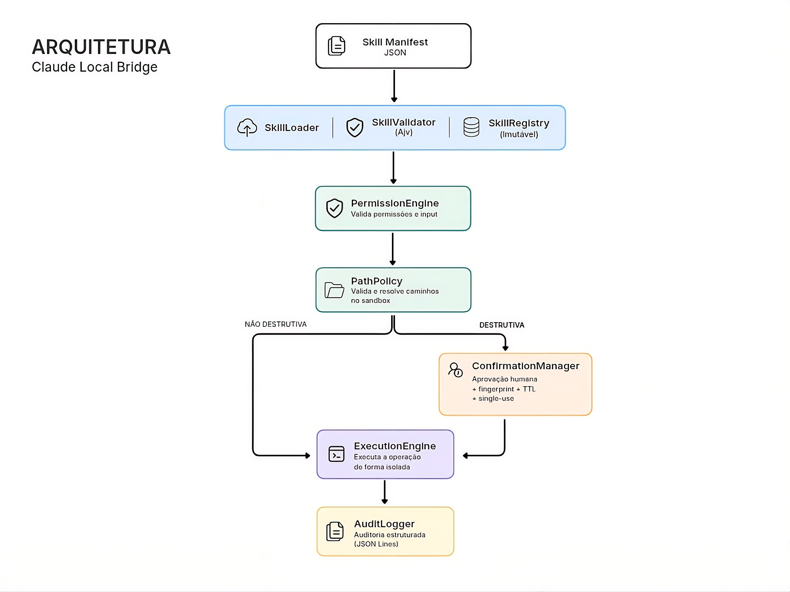

# Claude Local Bridge

Runtime local de ferramentas ("Skills") para permitir que um agente de IA
interaja com o sistema operacional de um usuário (arquivos, processos) de
forma mediada, auditável e com múltiplas camadas de validação — nunca
executando comandos arbitrários vindos diretamente do modelo.

## Status

**Em desenvolvimento — fundação de segurança implementada, sem interface
de usuário, sem orquestrador de ponta a ponta e sem conexão real com um
modelo de IA ainda.** As camadas abaixo existem, são testadas
isoladamente, mas ainda não estão "ligadas" em um fluxo único chamável
externamente.

## Ideia central

Uma Skill não é um comando de shell — é um contrato declarativo (manifesto
JSON) validado por schema, com permissões explícitas, metadado de
destrutividade obrigatório, e paths restritos a um sandbox. Cada etapa da
execução passa por uma camada de decisão independente e testável antes de
qualquer coisa tocar o sistema operacional real.

Dois princípios guiam todas as decisões de arquitetura do projeto:

1. **Validação de schema não implica segurança da implementação.**
2. **Instruções de prompt para o modelo de IA não constituem uma fronteira
   de segurança.** Toda garantia real vive em código, nunca em texto que o
   modelo é instruído a seguir.

## Arquitetura



Cada seta acima é uma chamada de função real e testada — não há, hoje,
nenhum código que already conecte todas essas etapas automaticamente a
partir de uma mensagem de chat (isso é o "orquestrador", ainda não
implementado — ver [Não implementado](#não-implementado-ainda)).

## Estrutura do repositório

```
claude-web/
├── ai-skills/
│   ├── schemas/skill.schema.json      # contrato que todo manifesto de Skill deve seguir
│   └── manifests/workspace_cleaner.json  # única Skill declarada até agora
│
├── automation-python/
│   └── skills/fake_skill/runner.py    # fixture usada só pelos testes do ExecutionEngine
│                                       # (não é uma Skill real/funcional ainda)
│
├── backend-node/
│   ├── src/
│   │   ├── config/paths.js            # paths centralizados do projeto (raiz, schema, sandbox...)
│   │   ├── services/                  # SkillLoader, SkillRegistry, skillValidator
│   │   ├── security/                  # PermissionEngine, PathPolicy, ConfirmationManager
│   │   ├── execution/                 # ExecutionEngine, resolução do runner por skill
│   │   └── audit/                     # AuditLogger e adaptadores de evento por camada
│   └── test/                          # 130 testes, um arquivo por componente
│
└── sandbox/                            # raiz de filesystem restrita onde as Skills operam
```

## Camadas implementadas

| Camada | Responsabilidade | Testes |
|---|---|---|
| `SkillLoader` / `SkillRegistry` / `skillValidator` | Carrega, valida contra schema e registra manifestos de forma imutável e atômica | 8 |
| `PermissionEngine` | Valida o input de uma chamada contra o schema da própria skill e suas permissions declaradas | 15 |
| `PathPolicy` | Resolve e canonicaliza paths contra o sandbox; bloqueia traversal, paths absolutos e escape via symlink/junction | 43 |
| `ConfirmationManager` | Fluxo de aprovação humana para operações destrutivas: fingerprint de operação, TTL, uso único, proteção contra replay | 23 |
| `ExecutionEngine` | Executa a skill como processo filho isolado (sem shell, cwd/env restritos, timeout, limite de saída) | 10 |
| `AuditLogger` | Registra eventos de todas as camadas acima em formato estruturado, com redação de dados sensíveis, nunca lança | 26 |

**Total: 130 testes**, rodando com o test runner nativo do Node (`node --test`), sem dependência de framework externo de testes.

## Requisitos

- Node.js (test runner nativo `node:test` — sem versão mínima fixada ainda)
- Python (necessário para os runners de Skill; nenhum runner real existe ainda, só a fixture de teste)

## Rodando os testes

```bash
cd backend-node
npm install
npm test
```

## Decisões de segurança relevantes

- **Skill ≠ comando.** O manifesto declara capacidades (`permissions`,
  `pathFields`, `destructive`) — nunca uma string de comando a ser
  executada. Quem decide *como* isso vira uma execução real é sempre o
  `ExecutionEngine`, nunca o texto que um modelo de IA gera.
- **`destructive` é metadado do manifesto, imutável em runtime** — nunca
  um parâmetro que a chamada da skill possa alterar.
- **Confirmação humana é obrigatória para toda skill `destructive: true`**,
  e o `ExecutionEngine` recusa executar sem uma confirmação consumida com
  sucesso — essa checagem vive no próprio motor de execução, não depende
  de quem o chama lembrar de verificar antes.
- **Fingerprint de operação (SHA-256, serialização canônica)** garante que
  uma aprovação corresponde exatamente à operação que será executada —
  nunca se confia em dados brutos reenviados depois da validação inicial.
- **Paths nunca são re-resolvidos a partir do input bruto** depois que o
  `PathPolicy` já os canonicalizou — elimina uma classe inteira de bugs de
  TOCTOU (time-of-check to time-of-use).
- **Processos filhos rodam sem shell, com `cwd` fixo no sandbox e `env`
  restrito a uma allowlist mínima** — nunca herdam o ambiente completo do
  processo Node pai.
- **`AuditLogger` nunca lança**, mesmo se seu próprio destino de escrita
  falhar — uma falha de logging nunca pode derrubar uma decisão de
  segurança ou uma execução em andamento.

## Pendências arquiteturais conhecidas

Registradas deliberadamente como pendência, não como lacuna esquecida:

- **Validação específica de Windows não realizada.** O `PathPolicy` foi
  desenhado para lidar com paths absolutos, UNC, symlinks e junctions do
  Windows, e testado no que é possível simular em Linux — mas o
  comportamento real de junctions, reparse points e case-insensitivity do
  NTFS **precisa ser validado manualmente numa máquina Windows real**
  antes de considerar essa camada pronta para produção. O mesmo vale para
  o comportamento de `SIGTERM`/`SIGKILL` do `ExecutionEngine` no Windows.
- **Armazenamento em memória.** `SkillRegistry` e `ConfirmationManager`
  usam `Map` em memória — não sobrevivem a reinício do processo e não
  coordenam entre múltiplas instâncias/processos Node. Aceitável para o
  MVP de processo único.
- **Sem ID de correlação de ponta a ponta.** Não existe hoje nenhuma peça
  que gere um ID por requisição atravessando todas as camadas — o
  `AuditLogger` aceita `correlationId: null`. Isso é responsabilidade do
  futuro orquestrador.

## Não implementado ainda

- **Orquestrador** que combine as camadas acima num fluxo único a partir
  de uma chamada de ferramenta (`tool_use`) de um modelo de IA real.
- **Runner Python real** para `workspace_cleaner` — hoje só existe uma
  fixture de teste (`fake_skill`), sem lógica de negócio nenhuma.
- **WebSocket / servidor HTTP / frontend web** — nenhuma interface externa
  existe; todas as camadas são chamadas hoje só a partir de testes
  automatizados.
- **Integração real com a API do modelo de IA.**
- **Persistência** entre reinícios do processo.
